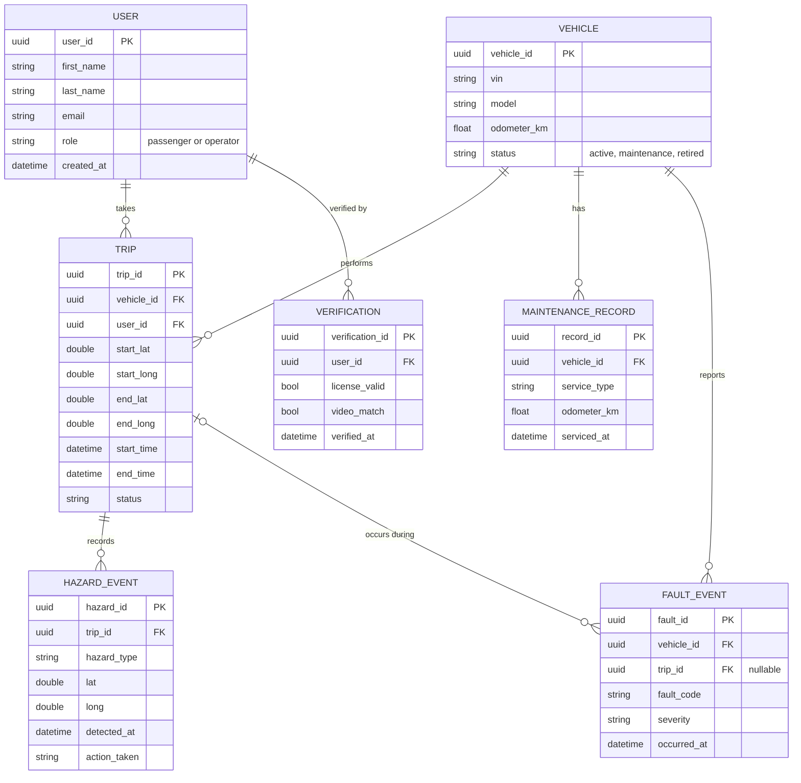

---------------------

## Software Design Specifications

---------------------

**Software Title:**

Autonomous Vehicle System

---------------------

**Members:** 

Marko Yovanovich  
Darrick Rios  
Andrew Dominic Lumba  
Nick Pasquale  
Jamai  
Nathan Shepard

---------------------

## SYSTEM DESCRIPTION

**Brief Overview of System:**

The Autonomous Vehicle System is a system that provides assistance for commercial 4-wheel vehicles. The system uses sensors and cameras to detect obstacles, monitor vehicle conditions, and alert the driver, who will remain responsible for driving. 

---------------------

## SOFTWARE ARCHITECTURE DIAGRAM 2.0

---------------------

### 1 Central Database Design (SQL)

**Design notes**

- **UUIDs as primary keys.** The vehicle creates trip, hazard, and fault records while offline, so it cannot ask the cloud for the next ID number. A UUID can be generated on the vehicle and is guaranteed not to collide with records from any other vehicle.
- **Coordinates are stored as `double`.** Integers or single-precision floats lose too much accuracy for vehicle positions.
- **`trip_id` on `FAULT_EVENT` is nullable** because a fault can happen while the vehicle is parked.
- **Verification is its own table**, so sensitive identity data is kept separate from the regular user profile and can have stricter access rules.

### 2 Onboard Database Design (SQL)

The onboard database has a few small tables:

| Table | Purpose |
|---|---|
| `current_route` / `waypoint` | The active route the Path Manager is following |
| `map_cache` | Map tiles for the area around the vehicle and its route |
| `vehicle_config` | Read-only copy of configuration sent from the cloud |
| `event_log` | Trips, hazards, and faults recorded on the vehicle, each with a `synced` flag |
| `sensor_buffer` | Rolling window of recent raw sensor data; oldest rows are overwritten |

### 3 Synchronization Strategy

We assume the vehicle syncs whenever it regains a connection. The process:

1. **Record locally first.** Every trip, hazard, and fault is written to `event_log` with `synced = false`, whether or not the vehicle is online.
2. **Upload when connected.** The Sync Client sends unsynced records to the Cloud API in the order they were created.
3. **Confirm, then mark.** A record is marked `synced = true` only after the cloud confirms it was saved. If the connection drops mid-upload, the record is simply sent again next time.
4. **No duplicates.** Each record has a UUID created on the vehicle, so if the same record arrives twice, the cloud recognizes it and ignores the copy.
5. **Download updates.** After uploading, the vehicle downloads any new route assignments, configuration changes, and map updates for its area.

**Who wins if data conflicts:** The vehicle is the authority on *what happened on the vehicle* (trips, hazards, faults). The cloud is the authority on *everything else* (users, configuration, maps). Because each side owns different data, the two databases never edit the same record, which avoids most sync conflicts.

**Timestamps** use GPS time rather than the vehicle's internal clock, so events from different vehicles can be compared accurately.

### 4 Sensitive Data

The system stores personal data (names, contact information, trip locations) and identity verification data. Our protections:

- **Encryption** of data in transit (all vehicle-to-cloud traffic uses TLS) and at rest in both databases.
- **Store the result, not the raw video.** Identity verification video is used to check the user and then deleted. Only the result (`license_valid`, `video_match`, timestamp) is kept.
- **Least privilege.** Maintenance staff can see vehicle and fault data but not user verification records.
- **Minimal data on the vehicle.** The onboard database holds no user account or verification data. If a vehicle were stolen, it would not expose user records.
- **Retention limits.** Raw sensor buffers are overwritten automatically, and trip location history can be deleted after a set period.

---
